# DriveACT: Imitation Learning for Autonomous Driving Using Action Chunking Transformers

A full-size, physically simulated car learns to drive through urban test tracks in NVIDIA Isaac Lab with
**Action Chunking with Transformers (ACT)**: it follows two-lane roads, turns at intersections, adjusts its speed,
passes parked cars, cone tapers and concrete barriers in the opposite lane, returns to its lane and stops at the
destination. The policy is trained offline from demonstrations of a privileged scripted expert and observes only
a planar LiDAR, its own state and local route information.

<p align="center">
  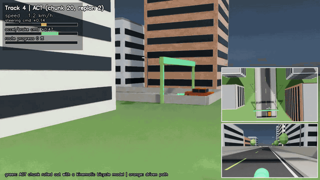
  <br/>
  <em>Final ACT policy on an unseen Track 4 city route (test layout 1001, episode 2), 6× speed: success in
  81.9 s. Full video: <code>videos/test_episodes/track4_layout1001_episode2/composite.mp4</code>.</em>
</p>

<p align="center">
  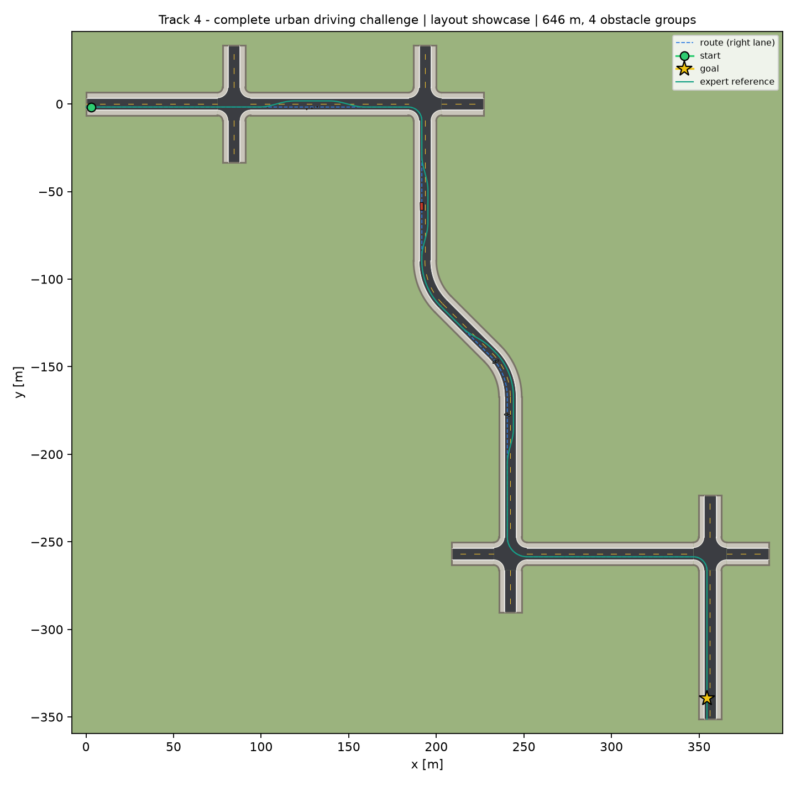
  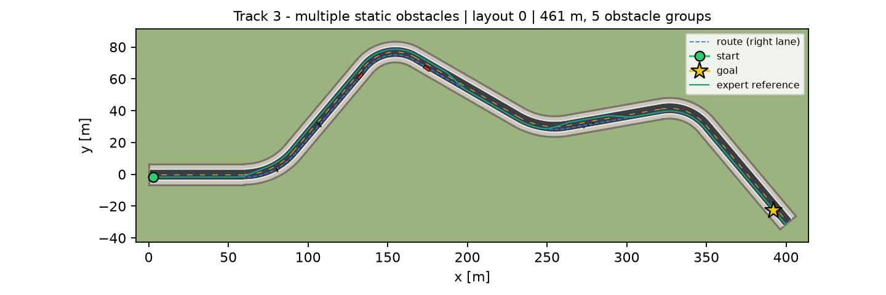
  <br/>
  <em>Track 4 showcase layout (held out from training) and Track 3 with one sampled obstacle configuration.
  Dashed blue: route (right lane); teal: the expert's planned reference path.</em>
</p>

> **Status (honest summary).** Stages 1–7 are done and measured in Isaac Lab: vehicle physics checks pass, the
> expert completes 64/64 episodes, 1,083 demonstrations were collected, and ACT, single-step BC and ablations were
> trained and evaluated on held-out layouts. **Headline result:** on held-out Track 4 city layouts ACT reaches
> 41/48 (85 %), BC 45/48 (94 %), the expert 48/48; on Track 3 ACT 60 %, BC 81 % — in this setting ACT did **not**
> outperform BC (single training run each; see the findings in [Results](#3-results-so-far)). Stage 8 videos of the
> final ACT are in `videos/`.

---

## Contents

1. [Task](#1-task)
2. [Method](#2-method)
3. [Results so far](#3-results-so-far)
4. [Reproducing](#4-reproducing)
5. [Repository structure](#5-repository-structure)
6. [Design notes](#6-design-notes)
7. [Status and limitations](#7-status-and-limitations)

Architecture, reference analysis and the implementation plan: [`docs/architecture.md`](docs/architecture.md).

---

## 1. Task

| | |
|---|---|
| Vehicle | full-size car articulation (4.40 m × 1.80 m, wheelbase 2.70 m, 1446 kg), Ackermann steering (±35°, 45°/s), 4 driven wheels, PhysX tyre contact; no reverse |
| Action | `[steering, longitudinal acceleration]` ∈ [−1, 1]², at 10 Hz → ±35° and +3 / −6 m/s² |
| Observation | 120 LiDAR sectors (360°, 40 m, exact ray casting), speed, steering angle, yaw rate, previous commands, heading error, lateral offset, 8 route look-ahead points, next-intersection manoeuvre, distance to goal (150-D) |
| Roads | two 3.5 m lanes, curbs, 3 m sidewalks, concrete walls, 4-way intersections with 6 m corner radii |
| Success | stop within 2 m of the goal without any collision and without touching a curb |
| Failure | collision (wall, parked car, cone, barrier), leaving the route, overshooting the goal, timeout, getting stuck |

| Track | Content | Layouts |
|---|---|---|
| 1 basic | straights, gentle curves, two 90° corners; no obstacles | 8 train, 4 test (jittered variations) |
| 2 parked vehicle | two bends, one parked car blocking part of the right lane (random position) | 8 train, 4 test |
| 3 multiple obstacles | four bends, 1–3 parked cars, 1–2 cone tapers, 1–2 barrier groups, 0–1 car in the opposite lane | 8 train, 4 test |
| 4 urban | procedural city routes with 3–4 intersections (left, right, straight), curves and all obstacle types | 12 train, 6 + showcase **held-out** test |

Every obstacle configuration is checked by the expert's planner before use: a smooth lane change with ≥ 0.45 m
clearance to every obstacle and to both curbs must exist. Evaluation uses obstacle placements from a random stream
that is disjoint from the one used for data collection.

## 2. Method

**ACT** ([`driveact/models`](driveact/models)) follows Zhao et al. (RSS 2023):

* **CVAE encoder** (training only): Transformer over [CLS, vehicle state, 20 future expert actions] → μ, log σ² of a
  32-D latent z (reparameterisation, KL to N(0, I)).
* **Policy**: tokens [z, vehicle state, route, 15 LiDAR tokens from a 1-D conv over the sectors] → Transformer
  encoder (4 layers) → decoder (4 layers) with 20 learned action queries → linear head → **[B, 20, 2]**.
* **Loss**: masked L1 on the chunk + β·KL, β = 10. **Inference**: z = 0; a chunk is predicted every 2 control
  steps (receding horizon), or every step with temporal ensembling (w = exp(−0.01 i), oldest first).
* ≈ 10.7 M parameters; AdamW, lr 1e-4, batch 256.

**Baseline**: single-step behaviour cloning with the same observations and LiDAR stem and an MLP head.

**Expert** ([`driveact/experts`](driveact/experts)): privileged lateral-offset planner (cosine lane changes around
obstacles in the right lane, never into opposite-lane parked cars), curvature- and obstacle-aware speed profile
with a stop at the goal, pure pursuit and P speed control. Half of the collected episodes add Ornstein-Uhlenbeck
noise to the executed action while the clean expert action is recorded (DART), so the data contain recoveries.

**Simulation** ([`driveact/environments`](driveact/environments)): Isaac Lab, 100 Hz physics, 10 Hz control.
Track geometry (roads, curbs, sidewalks, walls), the car and all obstacles are generated procedurally as USD from
the same layout description that the LiDAR, the collision checks and the expert use. Headless training and
evaluation use the same geometry and vehicle dynamics as the visual mode, which only adds lights, decoration behind
the walls (buildings, trees, street lamps, start/goal gantries) and three cameras.

## 3. Results so far

All numbers in this section were measured in Isaac Lab (Isaac Sim 4.5.0, Isaac Lab 2.1.1) unless marked otherwise.

### Stage 1: vehicle physics (`scripts/test_vehicle.py`, `results/stage1/`)

| Check | Measured | Reference | Pass |
|---|---|---|---|
| settle (3 s, zero command) | drift 7.6 mm, upright | < 50 mm | ✓ |
| acceleration (+2 m/s² command) | 1.995 m/s² | 2.0 ± 15 % | ✓ |
| braking from 9.8 m/s (−6 m/s² command) | 9.18 m, 1.9 s, no reverse | v²/2a = 8.03 m (+35 % + 0.5 m allowed for actuator lag) | ✓ |
| turning radius at 5 m/s, 17.5° | 8.98 m | bicycle model 8.56 m (± 15 %) | ✓ |
| steering step 0 → 35° | 95 % after 0.9 s, final 34.5° | slew limit 0.74 s | ✓ |
| full brake at standstill | min speed 0.0, drift 7.8 mm | no reverse | ✓ |

<p align="center">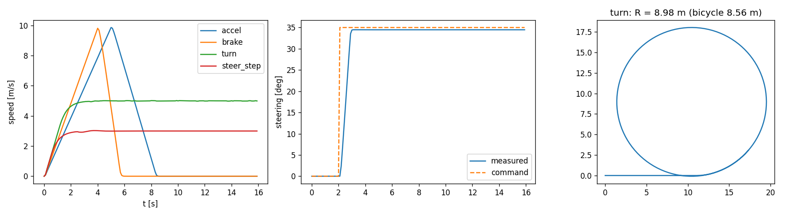</p>

### Stage 2: scripted expert in Isaac Lab (`results/stage2/`)

Scripted expert (privileged) driving the physics car on the training layouts, 16 episodes per track in 16
parallel environments (collection obstacle stream).

| Track | episodes | success | collisions | curb strikes | lane departures | obstacle groups passed | mean / max tracking error [m] | mean min. clearance [m] | travel time [s] | mean speed [m/s] |
|---|---|---|---|---|---|---|---|---|---|---|
| 1 | 16 | 16/16 | 0 | 0 | 0 | – | 0.067 / 0.37 | 0.79 | 41.7 | 7.97 |
| 2 | 16 | 16/16 | 0 | 0 | 0 | 16/16 | 0.059 / 0.38 | 0.79 | 34.2 | 7.37 |
| 3 | 16 | 16/16 | 0 | 0 | 0 | 89/89 | 0.060 / 0.40 | 0.74 | 68.8 | 6.76 |
| 4 | 16 | 16/16 | 0 | 0 | 0 | 79/79 | 0.069 / 0.45 | 0.78 | 87.5 | 6.71 |

Tracking error is the distance of the car centre from the expert's own reference path; clearance is the smallest
distance between the car body and any LiDAR-visible surface (walls included; on Track 1 it is the closing wall
behind the start position).

### Stage 3: demonstrations (`results/data/`)

Scripted expert on the training layouts (collection obstacle stream, 16 parallel environments). Half of the
episodes are disturbed with Ornstein–Uhlenbeck noise on the executed action (DART); only successful episodes are
written.

| Track | episodes run | written | timesteps | undisturbed success | disturbed success | wall time [s] |
|---|---|---|---|---|---|---|
| 1 | 200 | 188 | 78,323 | 94/94 | 94/106 | 206 |
| 2 | 200 | 200 | 68,252 | 107/107 | 93/93 | 173 |
| 3 | 300 | 297 | 204,566 | 143/143 | 154/157 | 430 |
| 4 | 400 | 398 | 339,940 | 173/173 | 225/227 | 863 |

In total 1,083 episodes and 691,081 timesteps (≈ 19 hours of driving at 10 Hz). All discarded
episodes are disturbed episodes that touched a curb.

### Stage 5 diagnosis: the copycat problem (`results/ablation_copycat/`)

The first ACT trained on Tracks 1–2 drove into the parked car in 47 of 48 held-out Track 2 episodes, even on the exact
training configurations, although its open-loop predictions on the demonstrations matched the expert's avoidance
manoeuvre closely. A step-by-step closed-loop trace (`scripts/diagnostics/closed_loop_trace.py`) showed the policy
cruising at 10 m/s with near-zero commands up to the obstacle, while the expert in the same states would brake from
≈ 40 m and steer from ≈ 25 m. The policy had learned to continue its previous command (the previous steering and
acceleration are observation features, and in the demonstrations they already contain the onset of every manoeuvre)
— the copycat shortcut known from behaviour cloning with action histories. Perturbing the previous-command features
during training removes the shortcut while keeping them as inputs:

| Policy (trained on Tracks 1–2, 25 epochs) | success on held-out Track 2 layouts | parked cars passed | collisions |
|---|---|---|---|
| ACT, previous commands as plain inputs (original) | 0/48 (CI 0–7 %) | 0/48 | 47 |
|   same model, on the training layouts with the training obstacle placements | 0/32 (CI 0–11 %) | 0/32 | 30 |
| ACT, previous commands with dropout 0.5 + noise 0.5 during training (**default**) | 43/48 (CI 78–95 %) | 43/48 | 5 |
| ACT without previous commands (ablation) | 46/48 (CI 86–99 %) | 46/48 | 2 |
| scripted expert | 48/48 (CI 93–100 %) | 48/48 | 0 |

These Track 2 test layouts were used for this diagnosis and for choosing the default; the Track 3 and Track 4
held-out sets were not used for any decision. All later stages use the default (dropout 0.5, noise 0.5).

### Stages 4–6: curriculum (ACT trained on the tracks so far, evaluated on held-out layouts of the newest track)

| Stage | training data | evaluated on (held-out layouts) | success | collisions | obstacle groups passed |
|---|---|---|---|---|---|
| 4 | Track 1 | Track 1 | 48/48 (100 %, CI 93–100) | 0 | – |
| 5 | Tracks 1–2 | Track 2 | 33/48 (69 %, CI 55–80) | 15 | 33/48 |
| 6 | Tracks 1–3 | Track 3 | 32/48 (67 %, CI 53–78) | 16 | 207/266 |

Training: 30 / 25 / 25 epochs
(8 / 13 / 34 min on one GPU).
The stage 5 model (68.8 %) was trained with exactly the same data and settings as the diagnostic run "dropout 0.5
+ noise 0.5" above (43/48 = 89.6 %): with one training seed per configuration, the run-to-run variance of ACT on
obstacle avoidance is large, and single-run differences of this size should not be over-interpreted.

### Stage 7: final comparison on held-out layouts (`results/stage7/`)

All learned policies were trained once on all four tracks' demonstrations (619,314
training timesteps; Track 4 training layouts only) for 15 epochs (ACT 36 min,
BC 2 min). Evaluation: 48 episodes per track on the held-out test layouts (Track 4: the
hand-designed showcase and 6 procedural layouts never used for training) with obstacle placements from the evaluation
stream. Success = stopped at the goal with no collision and no curb strike.

| Policy | Track 1 | Track 2 | Track 3 | Track 4 (held-out city layouts) |
|---|---|---|---|---|
| expert (privileged) | 48/48 (100 %) | 48/48 (100 %) | 48/48 (100 %) | 48/48 (100 %) |
| BC (single step) | 48/48 (100 %) | 48/48 (100 %) | 39/48 (81 %) | 45/48 (94 %) |
| ACT, chunk 20, replan every 2 steps | 48/48 (100 %) | 48/48 (100 %) | 29/48 (60 %) | 41/48 (85 %) |
| ACT, chunk 20, temporal ensembling | not run | not run | 7/48 (15 %) | 31/48 (65 %) |
| ACT without previous commands (ablation) | not run | not run | 37/48 (77 %) | 44/48 (92 %) |

Track 4 in detail:

| Policy | success | collisions | curb strikes | obstacle groups passed | lane departure | tracking error [m] | travel time [s] | mean \|Δsteer\| | mean \|Δaccel\| | latency [ms per car] |
|---|---|---|---|---|---|---|---|---|---|---|
| expert (privileged) | 48/48 (100 %, CI 93–100) | 0 | 0 | 243/243 | 0 % | 0.07 | 88.0 | 0.0095 | 0.0123 | 0.08 |
| BC (single step) | 45/48 (94 %, CI 83–98) | 3 | 0 | 236/243 | 56 % | 0.21 | 88.2 | 0.0099 | 0.0126 | 0.08 |
| ACT, chunk 20, replan every 2 steps | 41/48 (85 %, CI 73–93) | 7 | 0 | 226/245 | 60 % | 0.22 | 87.2 | 0.0097 | 0.0127 | 0.43 |
| ACT, chunk 20, temporal ensembling | 31/48 (65 %, CI 50–77) | 16 | 4 | 199/246 | 65 % | 0.40 | 82.5 | 0.0087 | 0.0107 | 0.36 |
| ACT without previous commands (ablation) | 44/48 (92 %, CI 80–97) | 4 | 1 | 234/244 | 56 % | 0.22 | 88.0 | 0.0101 | 0.0136 | 0.34 |

Track 3 in detail:

| Policy | success | collisions | curb strikes | obstacle groups passed | lane departure | tracking error [m] | travel time [s] | mean \|Δsteer\| | mean \|Δaccel\| | latency [ms per car] |
|---|---|---|---|---|---|---|---|---|---|---|
| expert (privileged) | 48/48 (100 %, CI 93–100) | 0 | 0 | 256/256 | 0 % | 0.06 | 67.9 | 0.0075 | 0.0117 | 0.06 |
| BC (single step) | 39/48 (81 %, CI 68–90) | 9 | 0 | 217/254 | 88 % | 0.71 | 70.4 | 0.0077 | 0.0099 | 0.10 |
| ACT, chunk 20, replan every 2 steps | 29/48 (60 %, CI 46–73) | 18 | 1 | 165/246 | 96 % | 0.84 | 70.9 | 0.0069 | 0.0098 | 0.59 |
| ACT, chunk 20, temporal ensembling | 7/48 (15 %, CI 7–27) | 25 | 3 | 170/256 | 96 % | 0.72 | 67.7 | 0.0047 | 0.0064 | 0.57 |
| ACT without previous commands (ablation) | 37/48 (77 %, CI 63–87) | 11 | 0 | 205/259 | 81 % | 0.43 | 68.4 | 0.0083 | 0.0133 | 0.39 |

**Training distribution vs. generalisation.** On the Track 4 *training* layouts (with unseen obstacle placements)
the same ACT model reaches 41/48 (85 %, CI 73–93), the same as on the held-out layouts, so the remaining failures are not due
to unseen geometry.

<p align="center">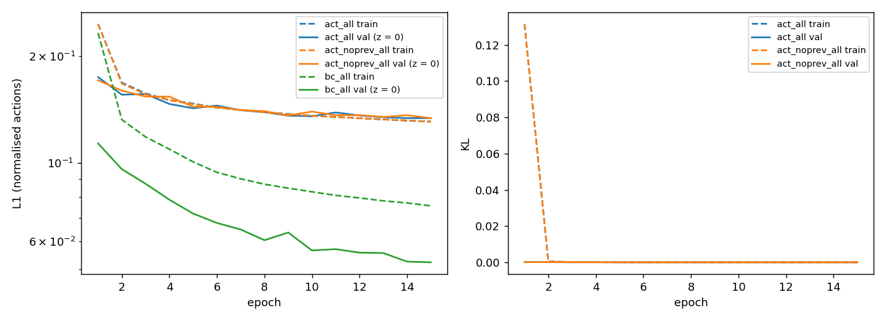<br/>
<em>Training curves of the final models. ACT's L1 is over the whole 20-step chunk and is not comparable to BC's
single-step L1. ACT's training and validation losses are still close and still decreasing after 15 epochs.</em></p>

**Findings (from these single training runs; no tuning on the Track 3/4 test sets):**

* On Track 1 (no obstacles) and Track 2 (one parked car) the final ACT, BC and the expert all reach 100 %.
* With obstacles, **ACT with receding-horizon chunking did not outperform single-step BC** here: Track 3 60 % vs.
  81 %, Track 4 85 % vs. 94 % (the Track 4 confidence intervals overlap). Almost all failures of both policies are
  collisions with parked vehicles (ACT Track 3: 13 parked-car and 5 barrier collisions, 1 stuck; BC Track 3: 9
  parked-car collisions), not road departures.
* **Temporal ensembling hurts strongly** in this task (Track 3 15 %, Track 4 65 %; on Track 3 also 14 timeouts):
  averaging the predictions of up to 20 past chunks, weighted towards the oldest, delays the reaction to an
  obstacle that has just become visible.
* **ACT without the previous-command inputs** is better than ACT with them (Track 3 77 %, Track 4 92 %), consistent
  with the copycat diagnosis.
* Plausible reasons ACT trails BC here, not yet tested: the deterministic expert gives the CVAE nothing to model
  (KL → 0), the 20-step (2 s) chunk with replanning every 0.2 s is long relative to how quickly obstacles appear in
  the 40 m LiDAR range, and the 10.7 M-parameter model is still under-trained after 15 epochs (train ≈ validation
  loss). The chunk-size ablation (10 / 50), longer training and several seeds are the next experiments
  (`scripts/run_experiments.sh`).

> **Note on a fixed scene-geometry bug (2026-10-13).** In the first runs the static track meshes (curbs, sidewalks,
> walls) were authored in world coordinates *under* the cloned `/World/envs/env_i` prims, which already carry each
> environment's grid translation, so in multi-environment runs the physical curbs and walls were offset from the
> analytic geometry used by the LiDAR, the collision checks and the expert (the car, the ground and the obstacles
> were placed correctly, and outcomes were judged by the analytic checks, which is why most runs still succeeded).
> It showed up as one Track 4 layout failing consistently in one environment slot. The geometry is now authored under
> an untransformed `/World/Tracks/env_i`, layouts are centred on their grid points with a start-up overlap check,
> and every environment's wall mesh is verified against the analytic walls at start-up
> (`tests/test_scene_assets.py`, `tests/test_tracks.py`). After the fix the expert completed 32/32 Track 4 episodes
> in 16 parallel environments. All Isaac data and results from stage 2 onward were regenerated; stage 1 used no
> track geometry and the visual-mode renders used a single environment, so neither was affected.

### Stage 8: videos of the final ACT policy (`videos/`)

Episodes were fixed before rendering (episode 0; episode 1 for layout 1000), not selected by outcome; rendered with
`scripts/visualize.py`. Every
folder holds `composite.mp4` (chase view with HUD, top-down and bonnet insets), `chase.mp4`, `front.mp4`, `top.mp4`,
screenshots and `episode.json`. The green markers are ACT's predicted 20-step chunk executed on a kinematic bicycle
model from the current state (not a position output of the network); the orange markers are the driven path.

| Episode | folder | outcome | time [s] | obstacle groups passed |
|---|---|---|---|---|
| Track 4 showcase (held-out city route) | `videos/act_track4_showcase/` | success | 92.9 | 4/4 |
| Track 4 layout 1000 (held-out), overview camera | `videos/act_track4_layout1000_overview/` | success | 82.2 | 4/4 |
| Track 3 (held-out layout) | `videos/act_track3/` | success | 73.2 | 5/5 |
| Track 2 (held-out layout) | `videos/act_track2/` | success | 36.9 | 1/1 |
| Track 1 (held-out layout; first stage 4 model, trained before the previous-command fix) | `videos/act_track1/` | success | 43.2 | – |

The expert's run on the same showcase route (`videos/expert_track4_showcase/`) is kept for comparison.

<p align="center">
  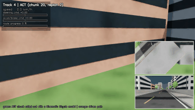 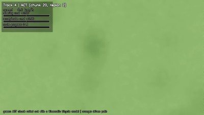<br/>
  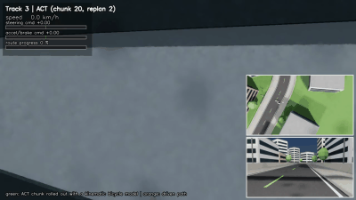 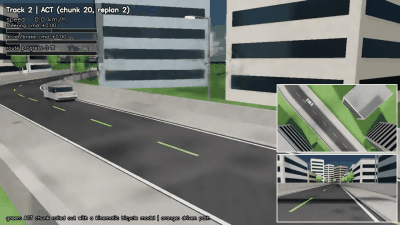<br/>
  <em>Final ACT policy, 6× speed: held-out Track 4 showcase, held-out Track 4 layout 1000 (top view), Track 3, Track 2.</em>
</p>

### Visual mode (Isaac Sim RTX rendering)

Rendered by `scripts/visualize.py` with the scripted expert on Track 2 (the same layouts, obstacles and vehicle
physics as headless runs; lights, decoration behind the walls and cameras are added).

<p align="center">
  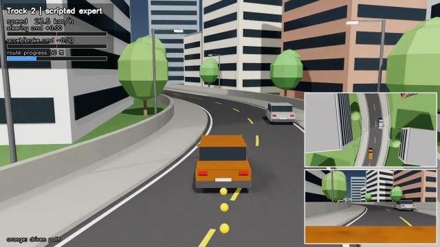<br/>
  <em>Composite video frame: chase camera with HUD (speed, commands, route progress), top-down and bonnet camera
  insets; the parked car ahead blocks part of the right lane.</em>
</p>
<p align="center">
  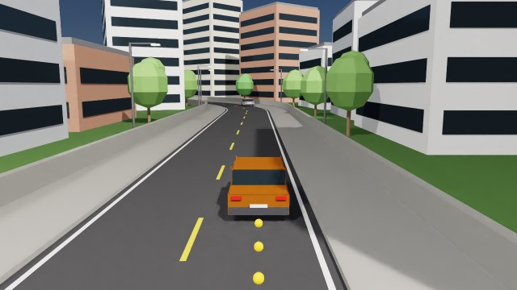 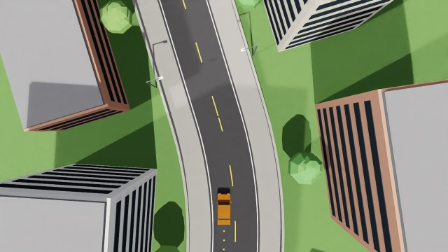<br/>
  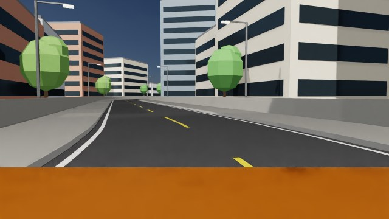 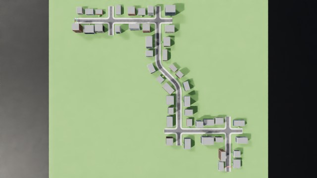<br/>
  <em>Chase, top-down (following), front (bonnet) and track-overview cameras.</em>
</p>

## 4. Reproducing

**Software.** Isaac Sim 4.5.0, Isaac Lab 2.1.1, PyTorch 2.7, Python 3.10, h5py, OpenCV, imageio (no other
dependencies). On a machine without Isaac Sim everything except simulation runs on the CPU test double
(`--backend kinematic`).

```bash
# unit tests (no simulator; 52 tests incl. ACT overfitting, CVAE/KL, alignment, raycasting, geometry)
python -m pytest -q tests

# environment, GPU availability, track configuration (does not start the simulator)
python scripts/check_environment.py --assets

# stage 1: vehicle physics checks
scripts/isaac.sh scripts/test_vehicle.py

# stage 2-8 (each Isaac step picks a GPU with spare capacity and refuses to start otherwise)
scripts/run_experiments.sh expert      # expert on every track
scripts/run_experiments.sh collect     # demonstrations -> data/track{1..4}_train.h5
scripts/run_experiments.sh train       # ACT per stage, final ACT and BC, chunk-size ablation -> checkpoints/
scripts/run_experiments.sh evaluate    # held-out layouts / unseen obstacles -> results/eval/summary.md
scripts/run_experiments.sh videos      # top-down, front and chase videos -> videos/

# individual steps
scripts/isaac.sh scripts/collect_demos.py --track 1 --episodes 200 --num_envs 16 --out data/track1_train.h5
python scripts/train_act.py --data data/track1_train.h5 --out checkpoints/act_track1
scripts/isaac.sh scripts/evaluate.py --policy act --checkpoint checkpoints/act_track1/best.pt --track 1 --split test --episodes 100 --out results/eval/act_track1
scripts/isaac.sh scripts/visualize.py --policy act --checkpoint checkpoints/act_all/best.pt --track 4 --layout_seeds -1 --out videos/act_track4
python scripts/plot_tracks.py --out results/tracks

# CPU-only dry run of the whole pipeline (test double, ~5 min)
scripts/smoke_pipeline.sh kinematic
```

`scripts/isaac.sh` activates the Isaac Lab virtual environment (`$ISAACLAB_VENV`, default `~/envs/isaaclab`),
sets `OMNI_KIT_ACCEPT_EULA=YES` and runs the script headless.

## 5. Repository structure

```
configs/
  vehicle.yaml  sensors.yaml  act.yaml  expert.yaml  road.yaml  obstacles.yaml  sim.yaml  eval.yaml  visual.yaml
  tracks/track{1,2,3,4}.yaml        road-piece recipes, obstacle groups, train/test layout seeds
driveact/
  tracks/        layout builder (straights, curves, intersections), layout generators, obstacle sampling
  vehicle/       control interface + actuator model, procedural car/obstacle USD, CPU test double
  sensors/       batched analytic planar LiDAR
  environments/  DriveEnv (observations, events, metrics), Isaac Lab backend, USD scene builder, route tensors
  experts/       lateral/speed planner (also the obstacle feasibility check), scripted expert
  datasets/      HDF5 demonstration store, chunk sampler and normalisation
  models/        ACT (cvae.py, transformer.py, act_policy.py), BC baseline, closed-loop controller
  training/      offline trainer (checkpoints, CSV/TensorBoard logs)
  evaluation/    rollouts (incl. DART noise), metrics with Wilson intervals
  visualization/ top-down plots, Isaac cameras/markers, HUD and video, chunk -> path roll-out
scripts/         check_environment, test_vehicle, collect_demos, train_act, evaluate, visualize, plot_tracks,
                 summarize_results, run_experiments.sh, smoke_pipeline.sh, isaac.sh
tests/           unit tests (pure PyTorch / NumPy; USD tests need pxr)
docs/            architecture and reference analysis
results/         measured results (JSON/CSV/PNG); checkpoints/ and data/ are not versioned
```

## 6. Design notes

* **Why a procedural car.** Isaac Sim 4.5 has no full-size car asset (the Leatherback is a 0.42 m RC car;
  `basic_vehicle_m.usd` uses the PhysX-Vehicle API, which Isaac Lab articulations do not support). The car is an
  articulation with knuckle position drives and wheel velocity drives; it moves only through tyre forces.
* **Why analytic LiDAR.** Obstacles change every episode and differ between parallel environments; Isaac Lab's
  ray caster supports a single static mesh. Exact ray casting against the same geometry that is spawned in USD
  (walls, obstacle boxes, cone cylinders) gives synchronised, per-environment scans at negligible cost.
* **Collision ground truth.** Outcomes come from exact footprint-vs-geometry checks (identical in both backends);
  the chassis contact sensor is logged as an additional signal.
* **ACT decoder.** The reference implementation uses only the first of its 7 decoder layers (it reads index 0 of
  the stacked layer outputs). Here the last layer's output is used; `act.model.dec_layers: 1` reproduces the
  reference's effective depth.
* **Predicted trajectory in videos.** ACT outputs controls. The green path in videos is the predicted chunk executed
  open-loop on a kinematic bicycle model from the current state, not a position output of the network.

## 7. Status and limitations

**Done and verified**

* Stage 1: all vehicle physics checks pass in Isaac Lab.
* Stage 2: the scripted expert completes 64/64 episodes on the four tracks (and 48/48 on every held-out test set).
* Stage 3: 1,083 demonstrations (691k timesteps) collected in Isaac Lab; alignment and storage unit-tested.
* Stages 4–7: ACT, BC and ablations trained and evaluated in closed loop on held-out layouts (tables above).
* ACT/CVAE/Transformer, training, checkpointing, chunked and temporally-ensembled execution unit-tested.
* Visual mode with top-down, front and chase cameras, HUD and predicted-path markers renders in Isaac Sim.

**Not done / open**

* One training seed per configuration; the stage 5 repeat shows large run-to-run variance for ACT.
* Chunk-size ablation (10 / 50), longer ACT training and a larger LiDAR range have not been run.
* ACT does not yet beat single-step BC on the obstacle tracks in this setup (see the findings above).

**Limitations**

* Static world only (no traffic, pedestrians or traffic lights), by design.
* The analytic LiDAR is planar (one scan height); curbs are below it and are not seen. Cones are modelled as
  0.18 m cylinders for sensing and collision.
* No suspension (rigid chassis on four wheels); flat roads only.
* Decoration (buildings, trees, lamps) is placed behind the walls so that it cannot change what the planar LiDAR would
  see; it is visual only.
* The CPU test double has no tyre slip; it is used for tests and dry runs only and none of the reported numbers
  come from it.
